# Petstore 

## 1. Chạy server:
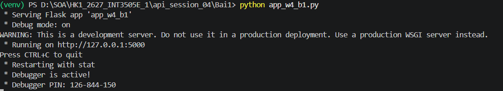

## 2. GET danh sách task:
Status code trả về:
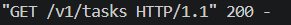
Kết quả
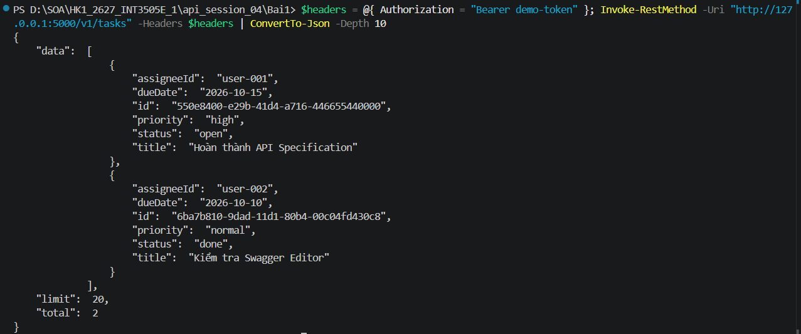

## 3. POST tạo task:
Status code trả về:
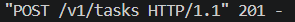
Kết quả
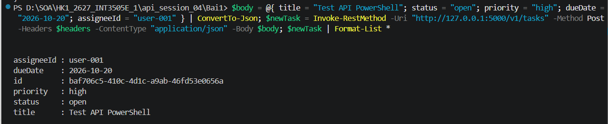

## 4. GET task theo ID:
Status code trả về:
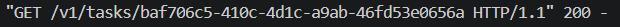
Kết quả
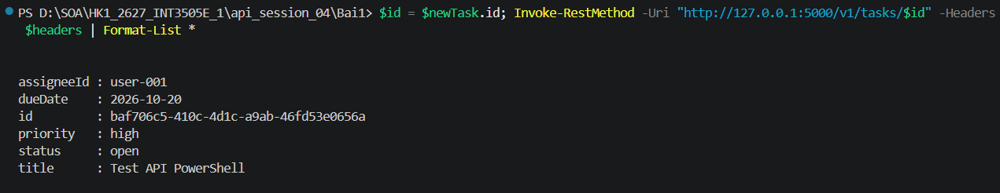

## 5. PATCH cập nhật task:
Status code trả về:
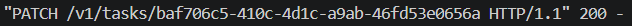
Kết quả:
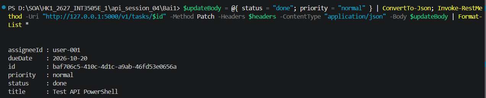

## 6. DELETE xóa task:
Kết quả:
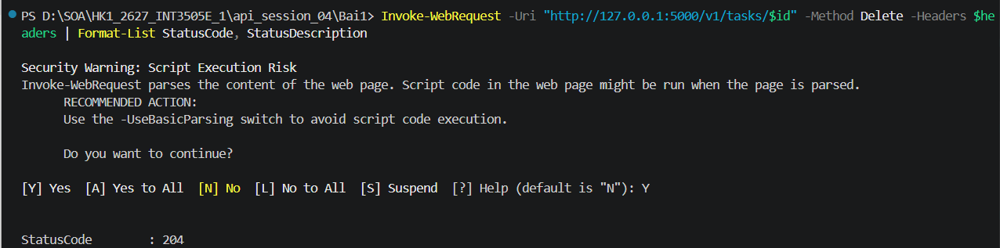

## 7. Giao diện Swagger:
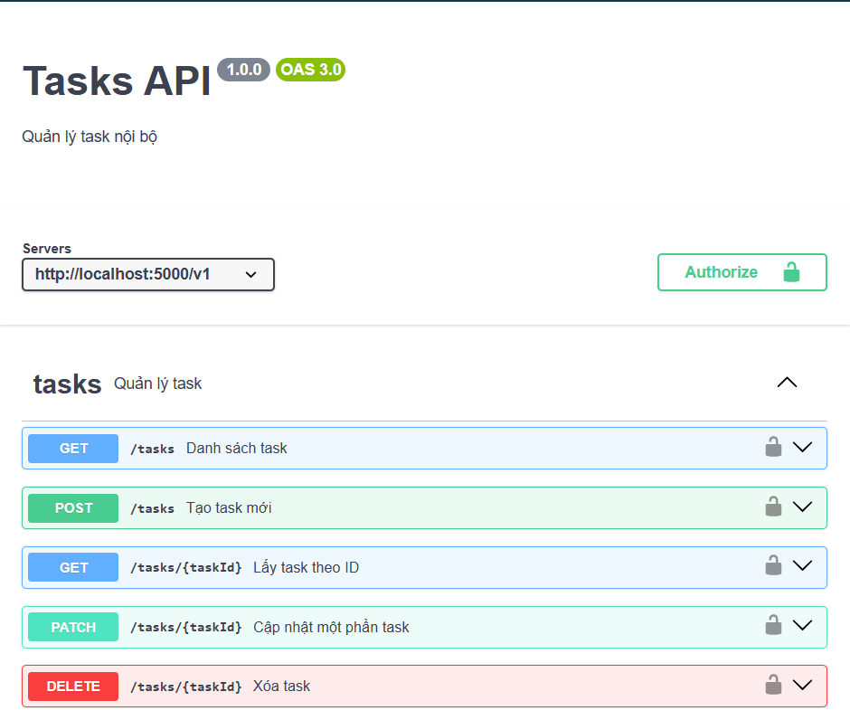
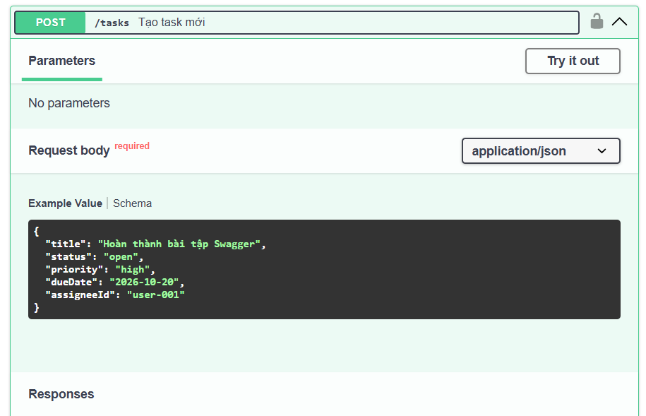
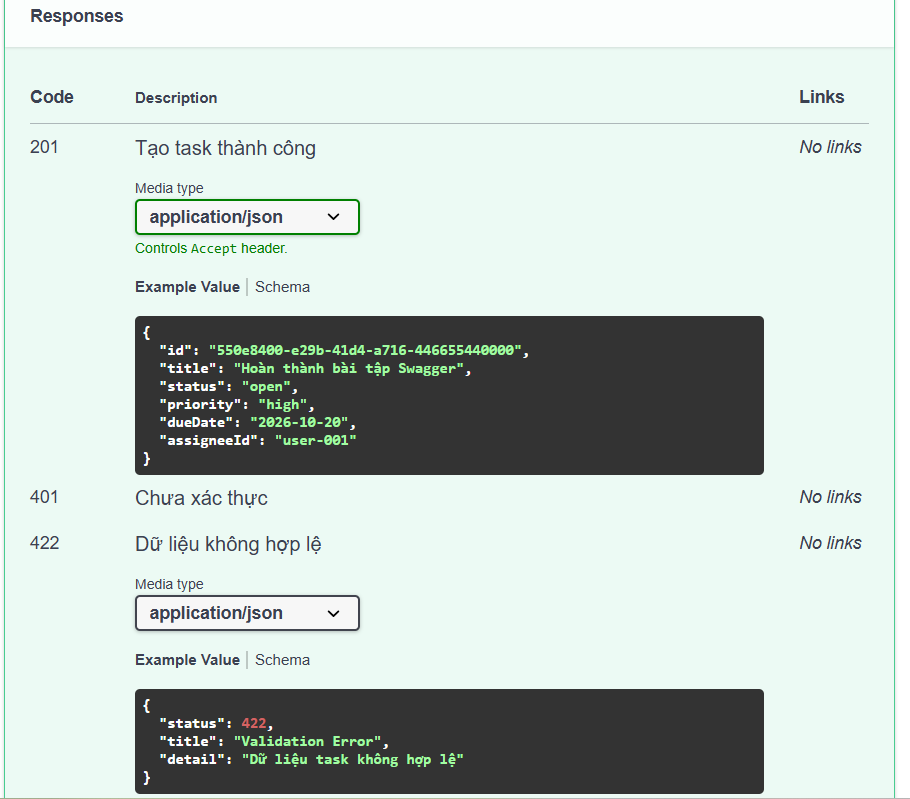
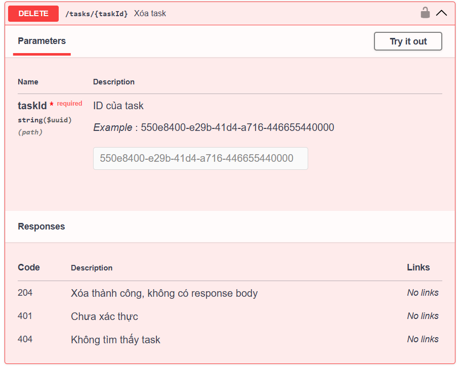
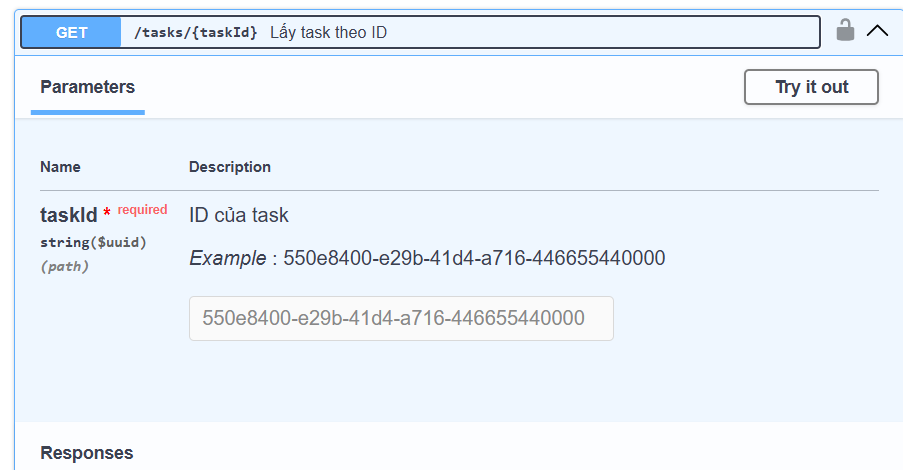
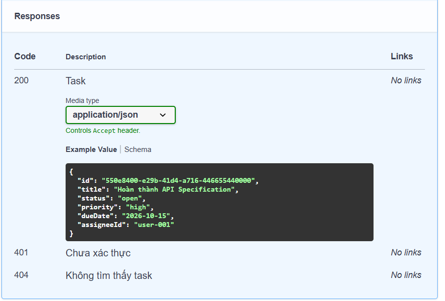
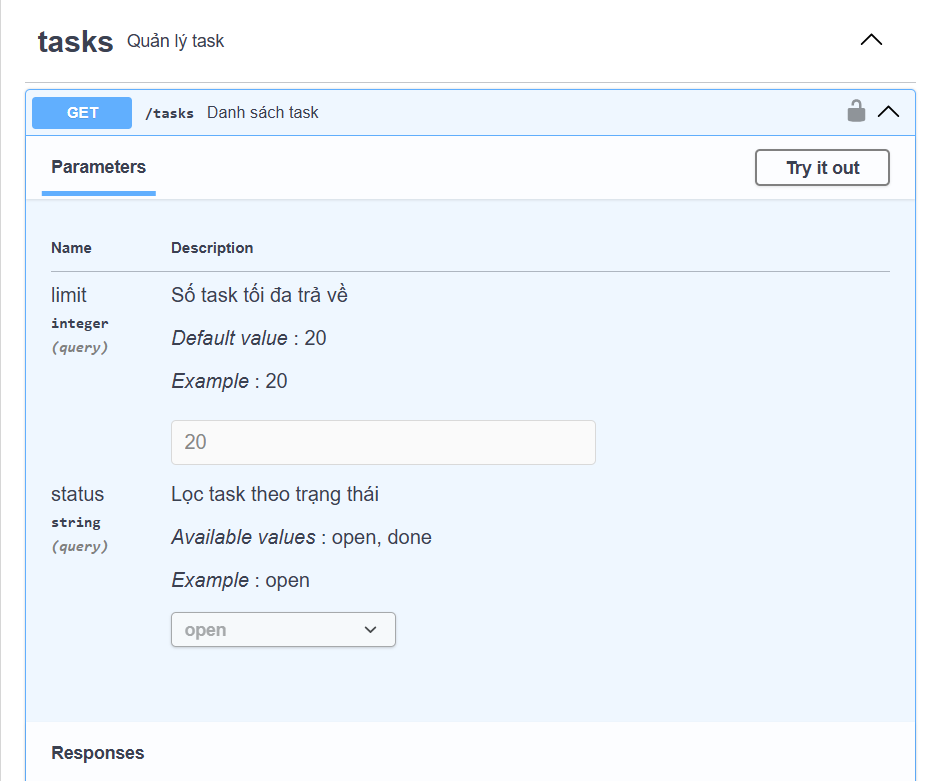
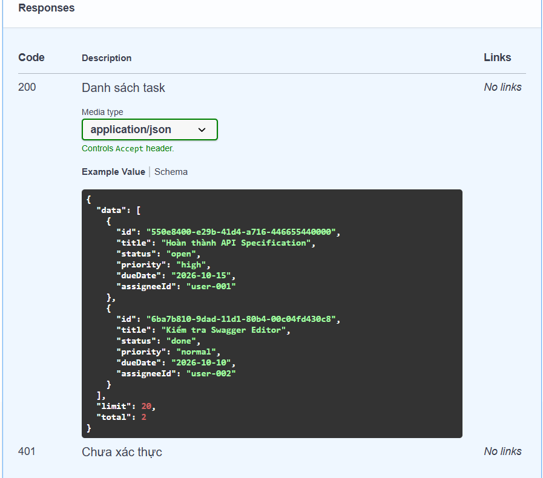
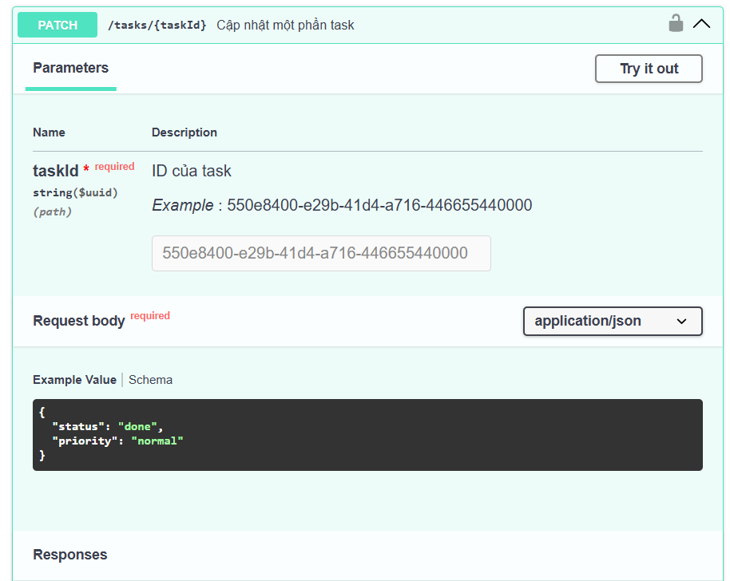
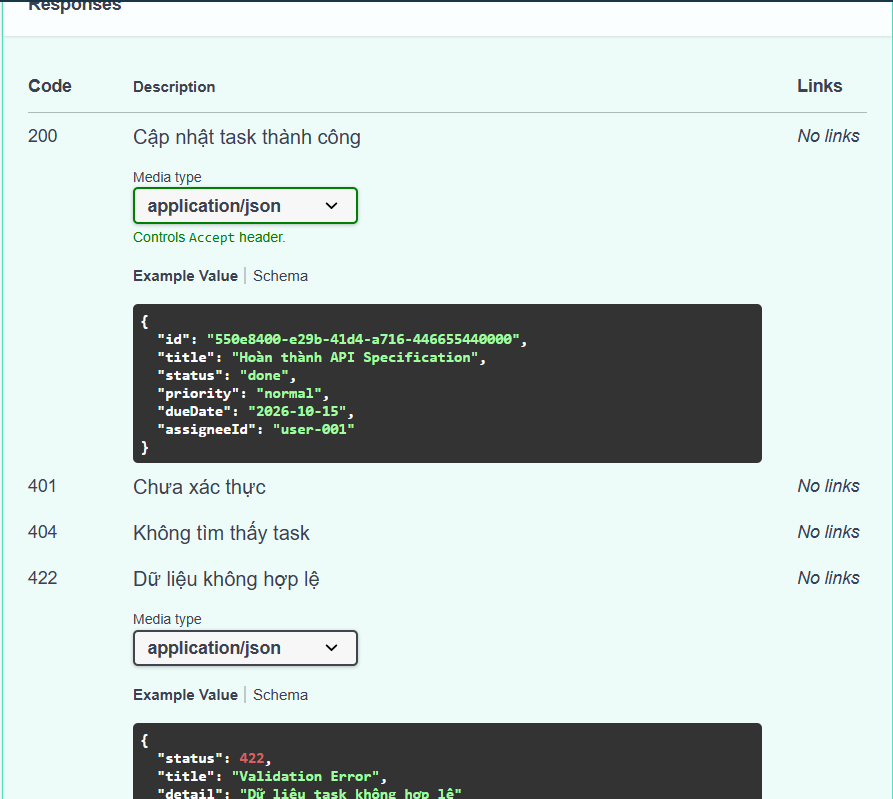
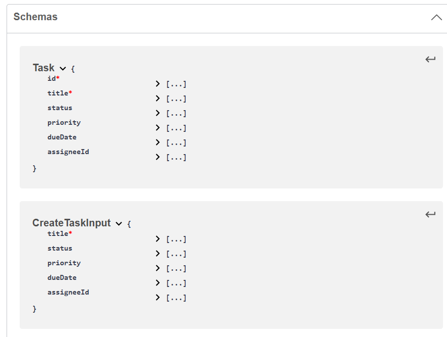
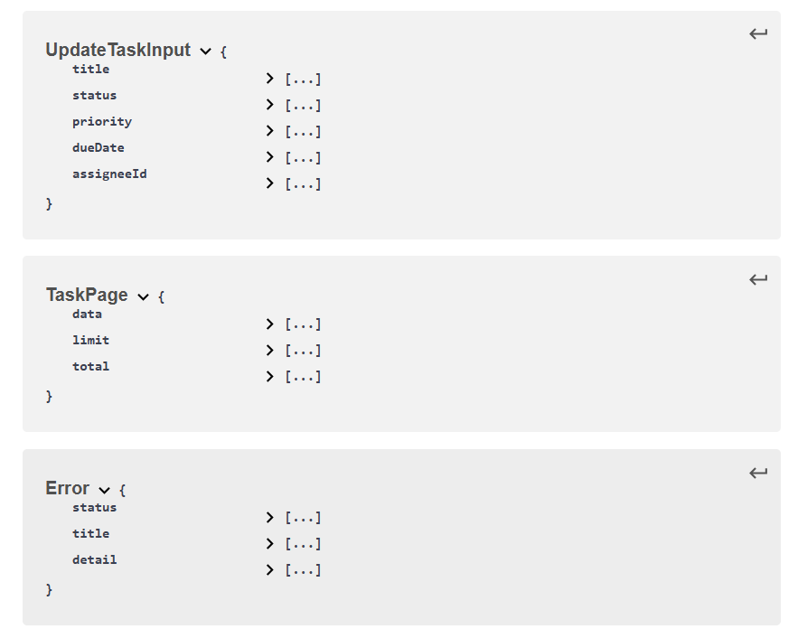

