# LAB 1: 

## 1. Chạy server:
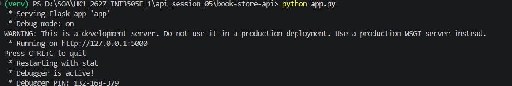

## 2. Tạo sách:
Status code trả về:

Kết quả
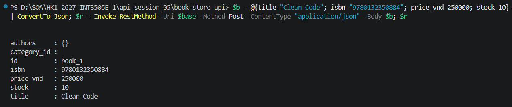

## 3. Lấy danh sách:
Status code trả về:
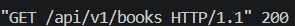
Kết quả khi mới chạy server:
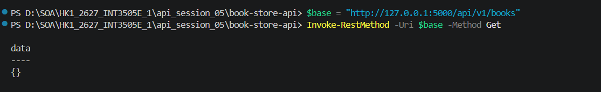
Status code trả về khi lấy lần 2:

Kết quả sau khi post tạo sách:

## 4. Cập nhật sách:
Status code trả về:
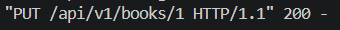
Kết quả

## 5. Xóa sách:
Kết quả:

## 6. JSON sai cú pháp:
Kết quả:
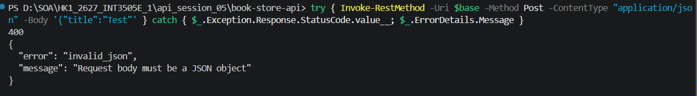

## 7. Thiếu trường bắt buộc:
Kết quả:
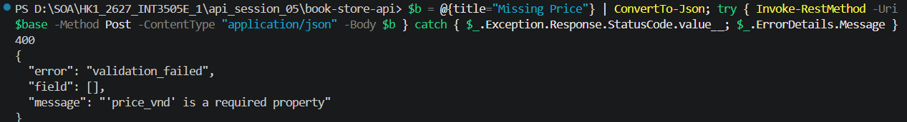

## 8. ID không tồn tại:
Kết quả:
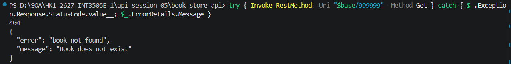

# LAB 2: PARSE_SORT VÀ FILTER 

## 1. Lấy danh sách mặc định:
Status code trả về:
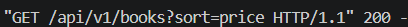
Kết quả
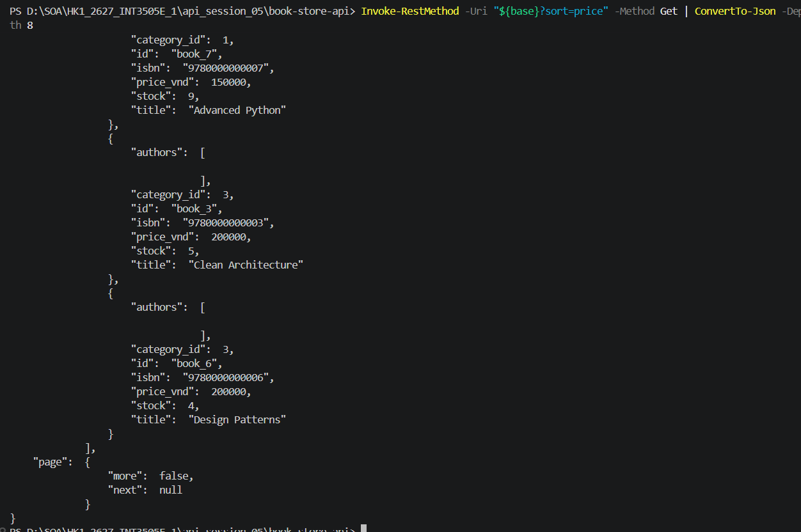

## 2. Sắp xếp giá tăng dần & giảm dần:
Sắp xếp tăng dần:
Status code trả về:

Kết quả sắp xếp giá tăng dần:

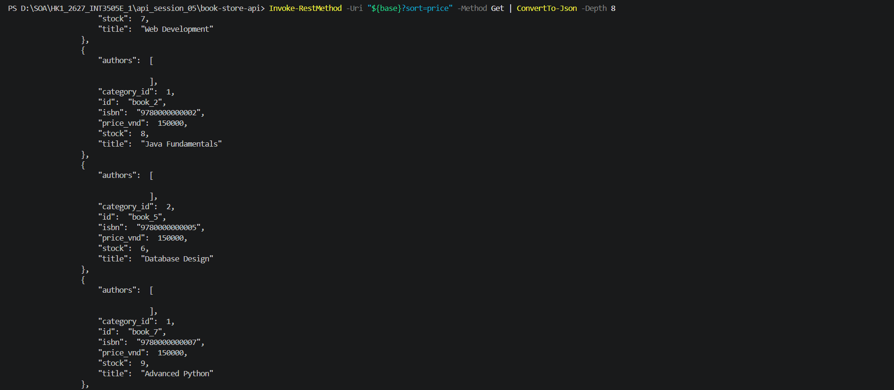
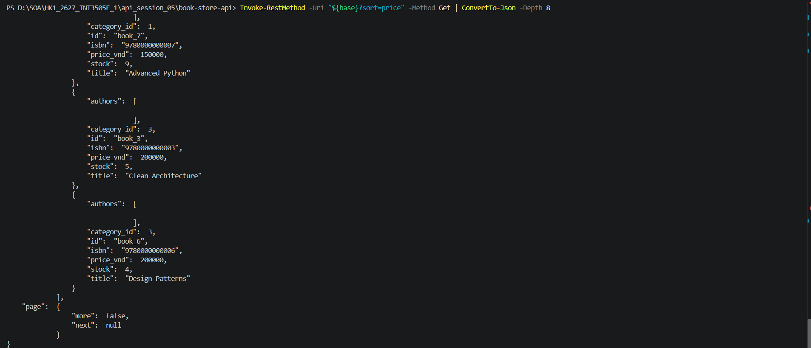

Sắp xếp giảm dần:
Status code trả về:
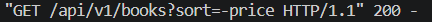
Kết quả sắp xếp giá giảm dần:

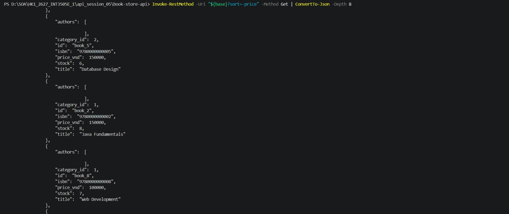

## 3. Sắp xếp ID giảm dần:
Status code trả về:
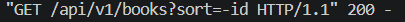
Kết quả sắp xếp ID giảm dần:
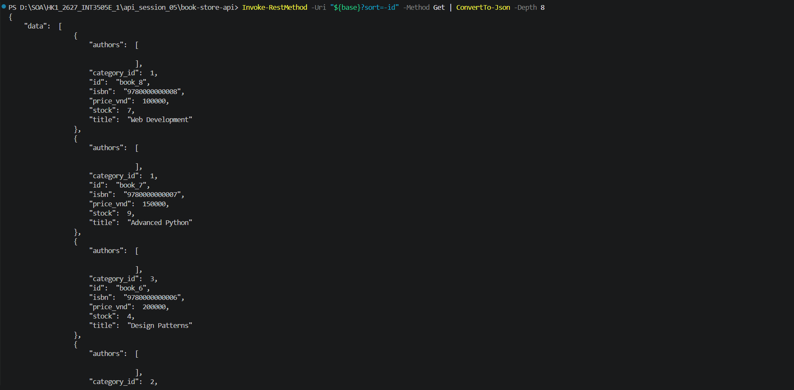
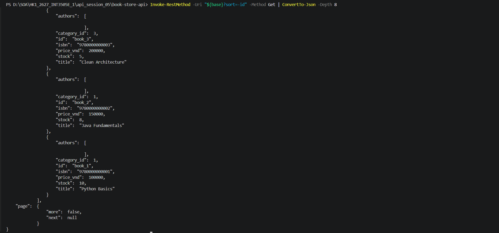
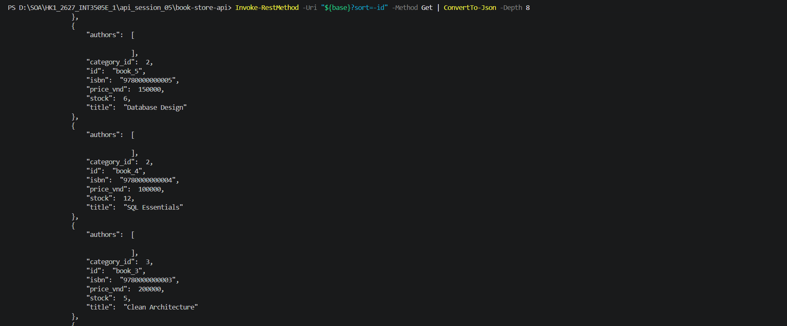

## 4. Sort không hợp lệ:
Status code trả về:

Kết quả:
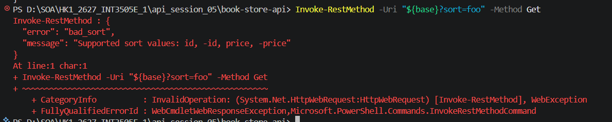

## 5. Sort nhiều trường:
Status code trả về:
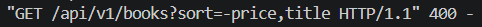
Kết quả:

## 6. Lấy một sách mỗi trang:
Status code trả về:
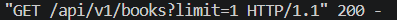
Kết quả:

## 7. Lọc theo danh mục:
Status code trả về:
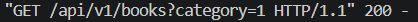
Kết quả:
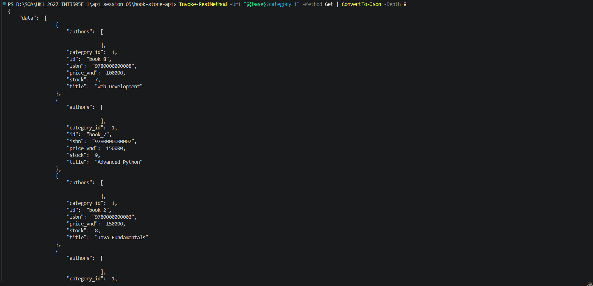

## 8. Test cursor:
Status code trả về:
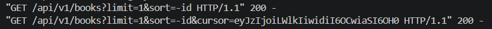
Kết quả:
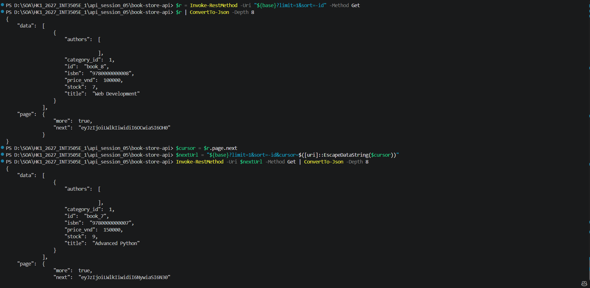

# BTVN SỐ 2: HOÀN THIỆN list_books Ở LAB 1: implement cả offset và cursor (chọn qua param ?strategy=... ) + thêm filter ?genre + sort multi-key.

## 1. Phân trang Offset với 3 bản ghi mỗi trang:
Status code trả về:

Kết quả
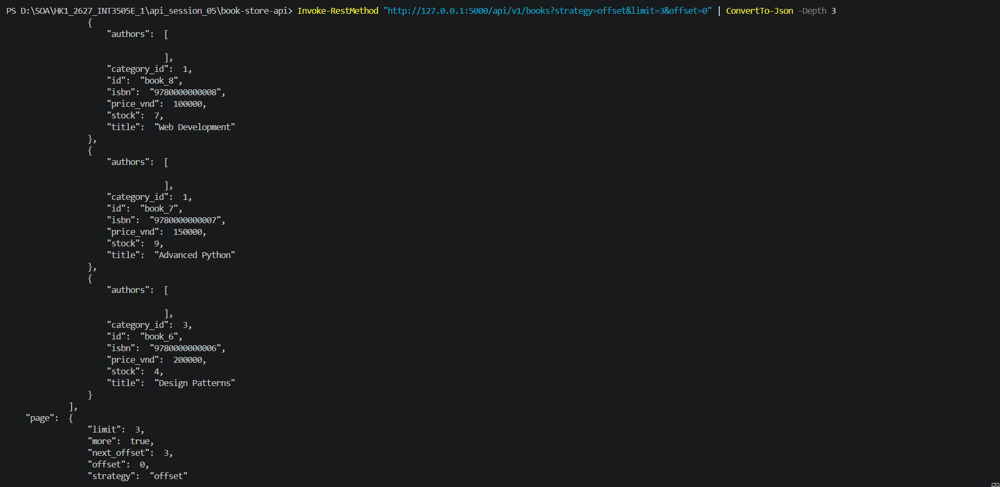

## 2. Phân trang cursor:
Status code trả về:

Kết quả:

## 3. Sắp xếp nhiều trường:
Status code trả về:
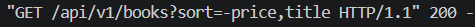
Kết quả:

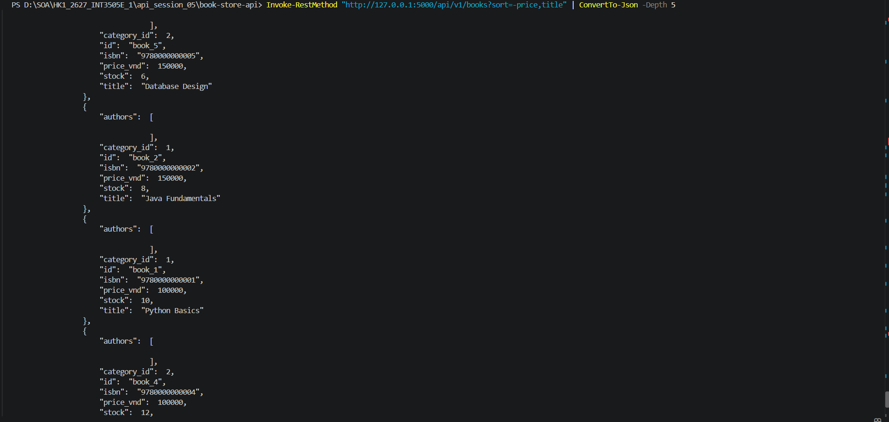
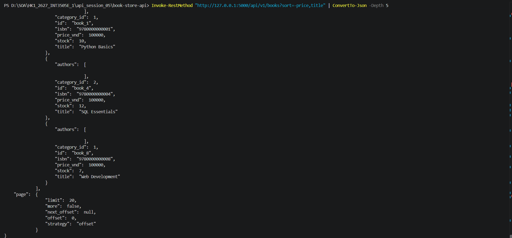

## 4. Strategy không hợp lệ:
Status code trả về:
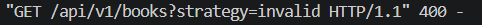
Kết quả:

## 5. Limit vượt giới hạn:
Status code trả về:

Kết quả:
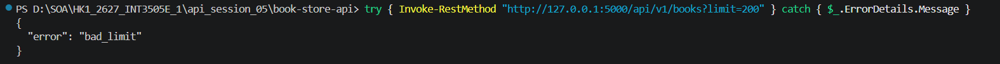

## 6. Kiểm tra cursor ràng buộc với bộ lọc và sắp xếp
Kiểm tra cursor với sort khác nhau:
Status code trả về:

Kết quả:

Kiểm tra cursor với genre khác:
Status code trả về:

Kết quả:

## 7. Kết quả với Postman:

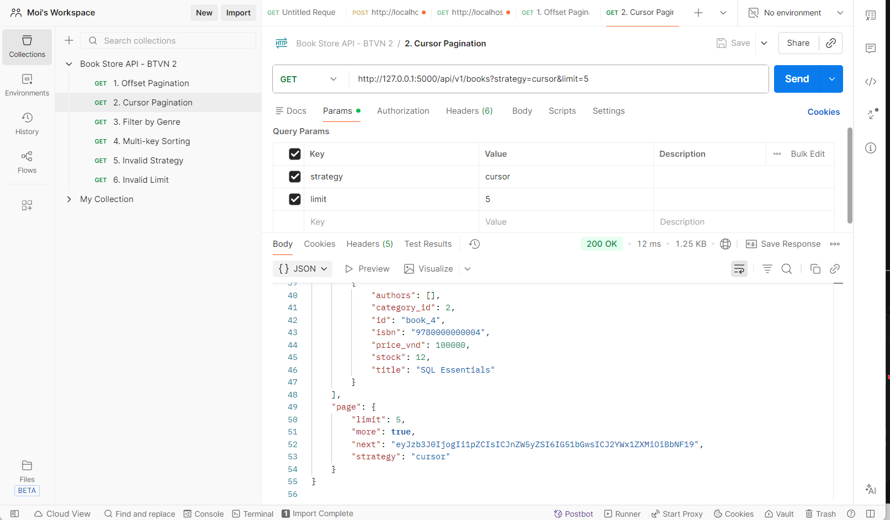

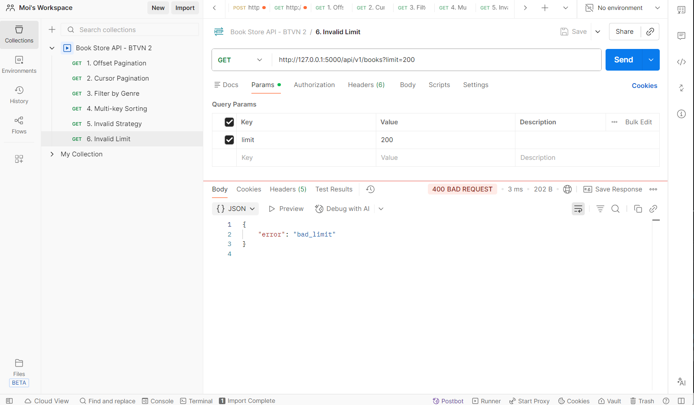