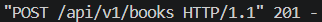
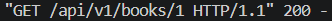
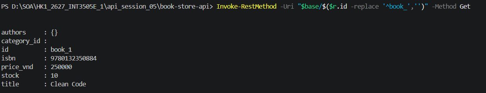
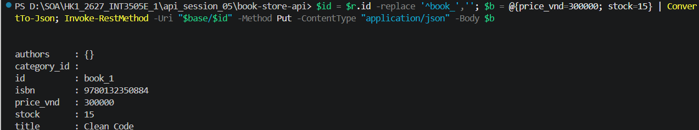
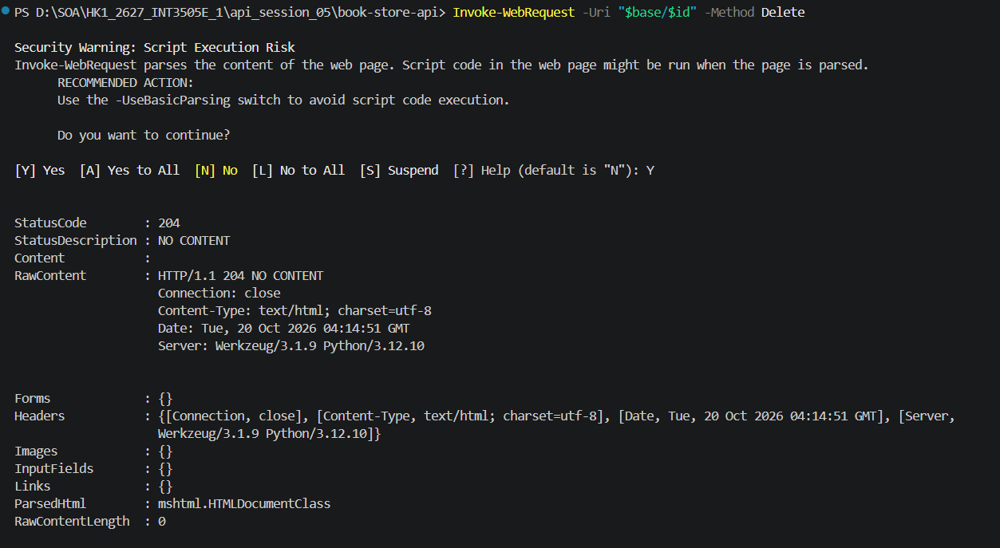

# LAB 1: 

## 1. Chạy server:

## 2. Tạo sách:
Status code trả về:

Kết quả

## 3. Lấy danh sách:
Status code trả về:

Kết quả khi mới chạy server:

Status code trả về khi lấy lần 2:

Kết quả sau khi post tạo sách:

## 4. Cập nhật sách:
Status code trả về:

Kết quả

## 5. Xóa sách:
Kết quả:

## 6. JSON sai cú pháp:
Kết quả:

## 7. Thiếu trường bắt buộc:
Kết quả:

## 8. ID không tồn tại:
Kết quả:

