# BTVN TUẦN 6:  KẾT QUẢ CHẠY app_hw6.py

## 1. Chạy server:
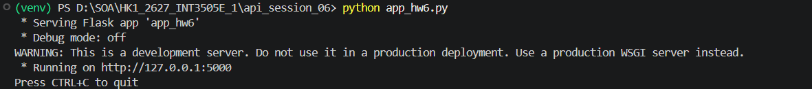

## 2. Đăng nhập thành công:
Status code trả về:
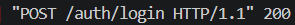
Kết quả
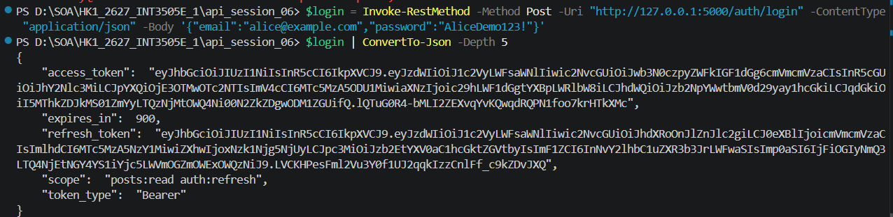
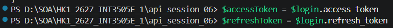

## 3. Đăng nhập sai mật khẩu:
Status code trả về:
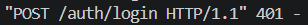
Kết quả:
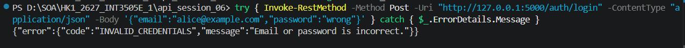

## 4. Đọc bài viết khi có quyền:
Status code trả về:
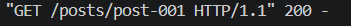
Kết quả
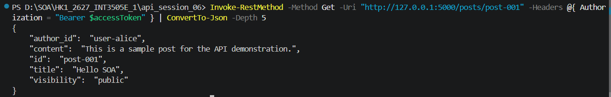

## 5. Truy cập không có token:
Status code trả về:
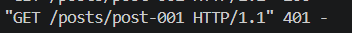
Kết quả:
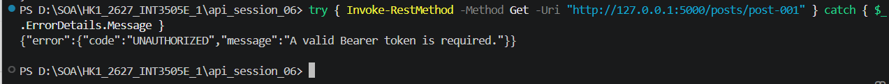

## 6. Token hợp lệ nhưng không đủ scope:
Status code trả về:
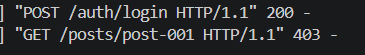
Kết quả:
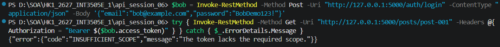

## 7. Bài viết không tồn tại:
Status code trả về:
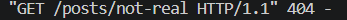
Kết quả:
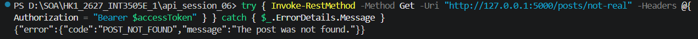

## 8. Làm mới token:
Status code trả về:
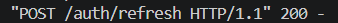
Kết quả:
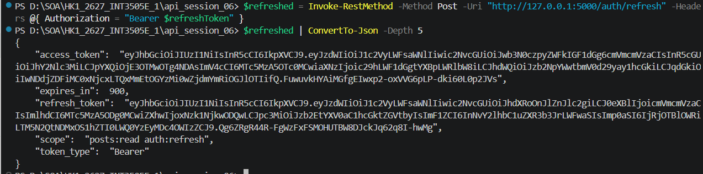

## 9. Thử lại với token cũ:
Status code trả về:
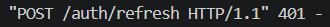
Kết quả
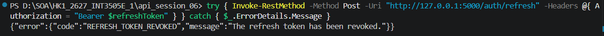

# BTVN TUẦN 6: KẾT QUẢ KIỂM THỬ VỚI SWAGGER:

## 1. POST
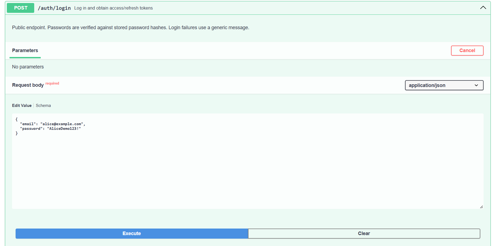
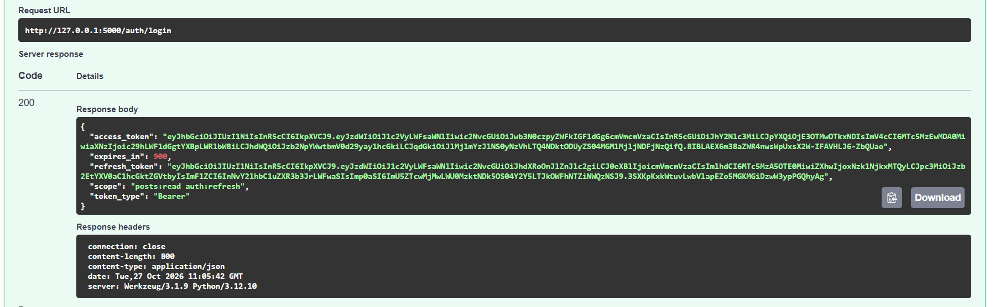

## 2. Refresh:
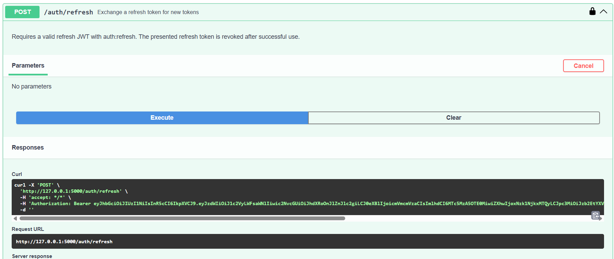
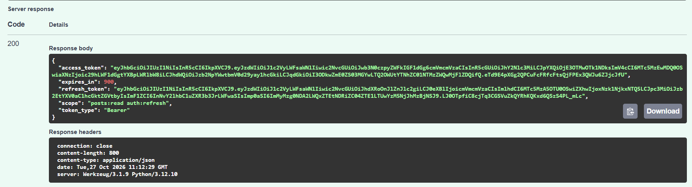

## 3. Lấy post theo ID;
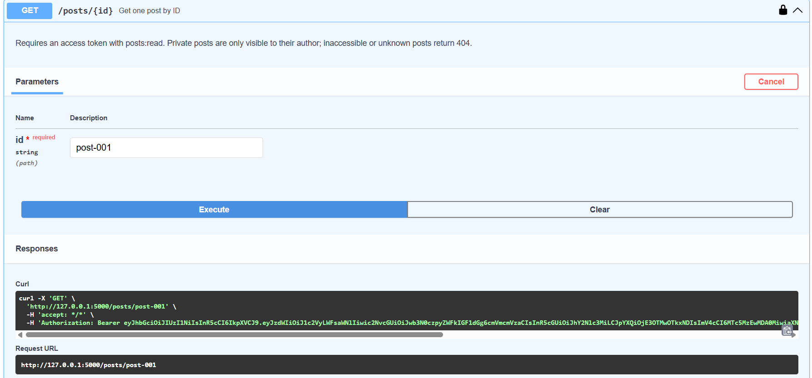
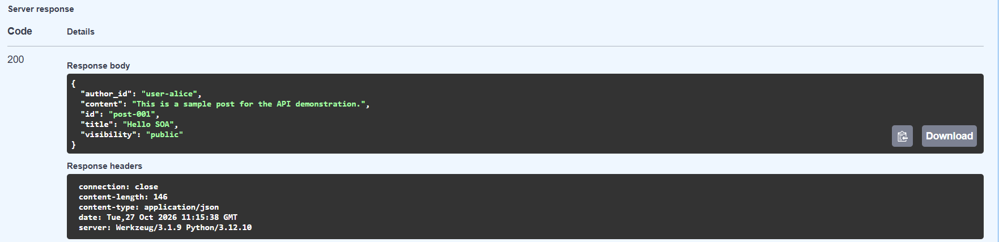
