# BTVN TUẦN 7: 

# TEST 6 ENDPOINT của LAB 1:

## 1. Chạy server:

## 2. Lấy toàn bộ danh sách sản phẩm:

## 3. Lấy sản phẩm với ID không tồn tại:

## 4. Tạo sản phẩm:

## 5. Cập nhật sản phẩm:

## 6. POST thiếu SKU/SKU đã tồn tại/Reserve vượt quá tồn kho:
POST thiếu SKU:

POST với SKU đã tồn tại:

POST Reserve vượt quá tồn kho:

## 7. POST/PATCH sản phẩm giá âm:
POST:

PATCH:

## 8. Xoá sản phẩm:

# TEST ENDPOINT với resource OderItems, Order:

## 1. Lấy danh sách đơn hàng:
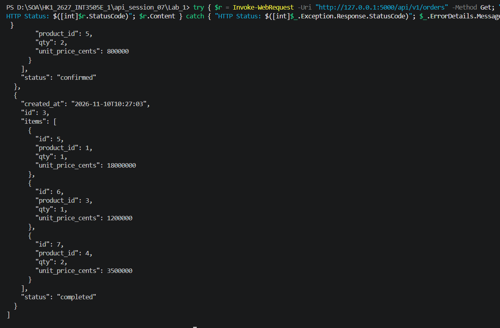

## 2. Lấy đơn hàng theo ID:
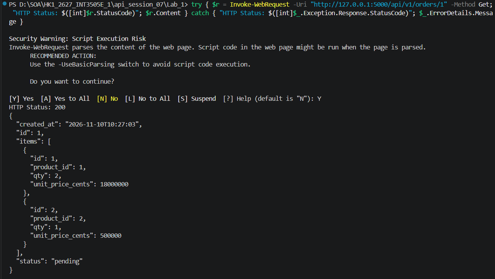

## 3. Tạo đơn hàng:
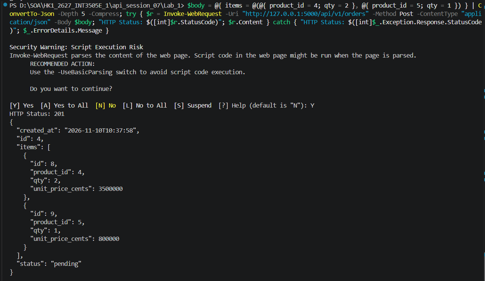

## 4. Tạo đơn hàng với ID không tồn tại/Lấy thông tin đơn hàng với ID không tồn tại:
POST:

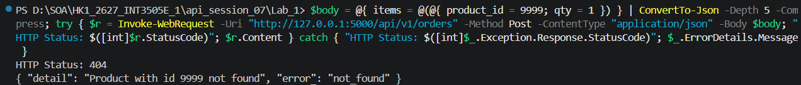

GET:

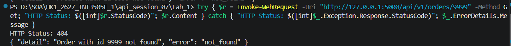

## 5. Thêm sản phẩm mới vào đơn hàng:
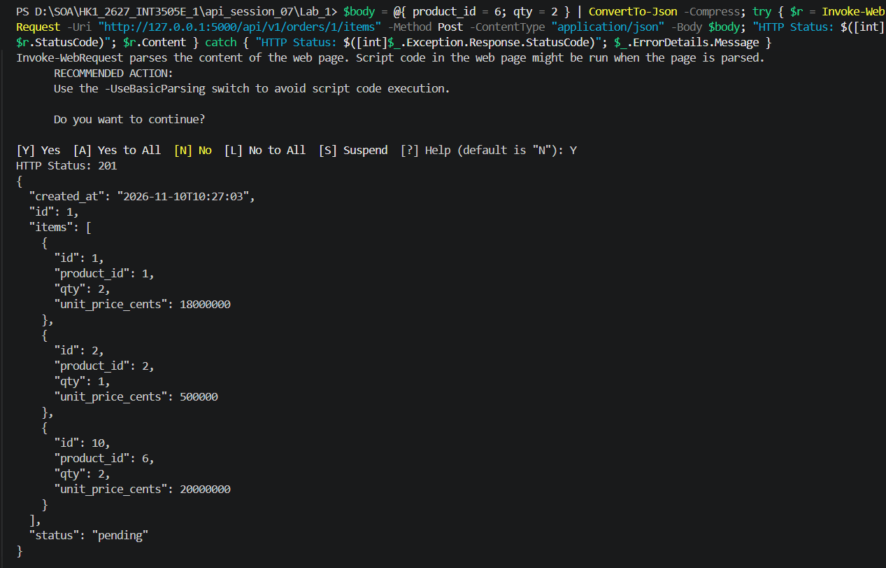

## 6. Tạo đơn hàng với số lượng bằng 0, sản phẩm trống, không có số lượng:
POST với qty = 0:

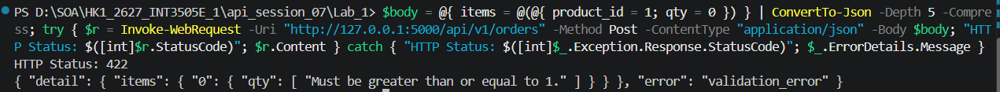

POST với sản phẩm trống:

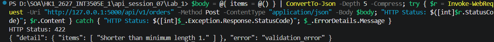

POST không có qty:

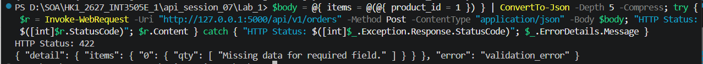

## 7. POST/PATCH sản phẩm giá âm:
POST:

PATCH:

## 8. Xoá sản phẩm:

# TEST DOCKER:

## 1. Kiểm thử API trong Docker:
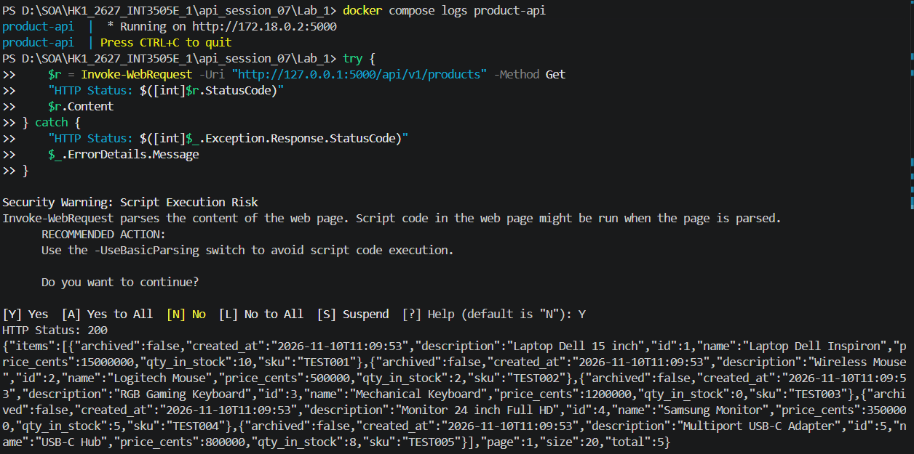
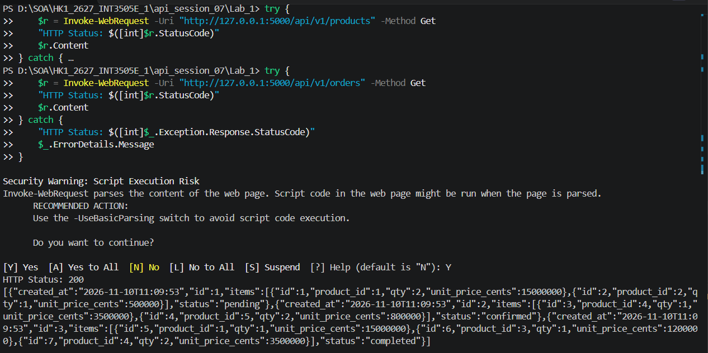

## 2. Kiểm thử khả năng lưu dữ liệu:
Dữ liệu hiện có:

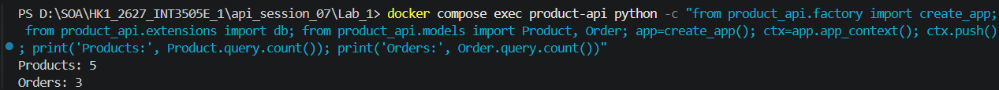

Dừng + khởi động lại container, kiểm tra lại dữ liệu:

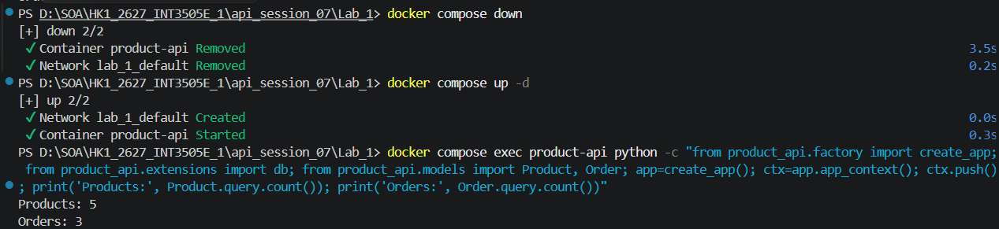

# TEST Healthz và Ready:

Healthz:

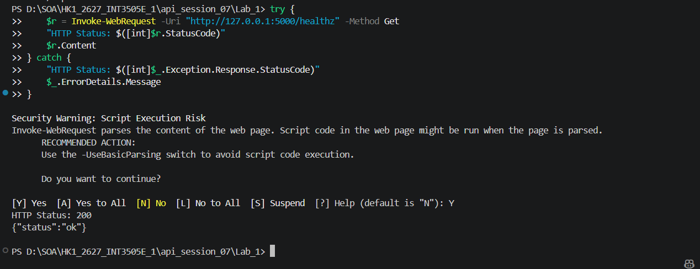

Ready:

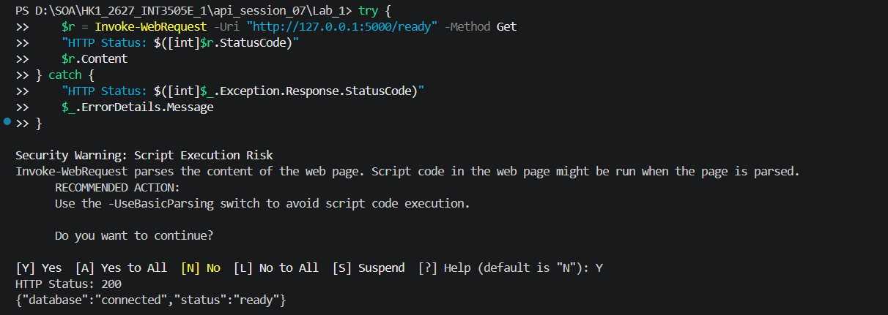
