# BTVN TUẦN 7: 

# TEST 6 ENDPOINT của LAB 1:

## 1. Chạy server:
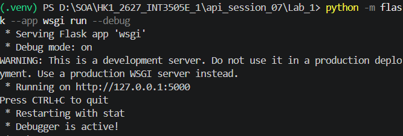

## 2. Lấy toàn bộ danh sách sản phẩm:
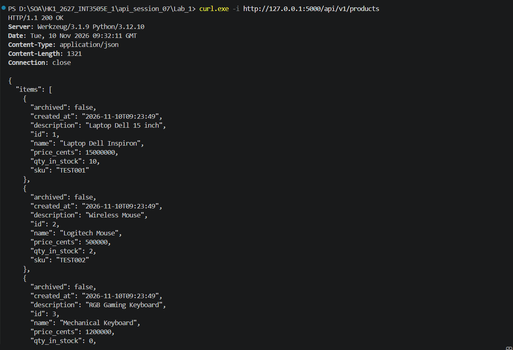

## 3. Lấy sản phẩm với ID không tồn tại:
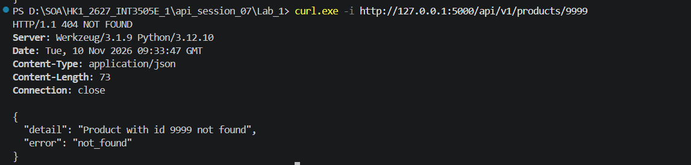

## 4. Tạo sản phẩm:
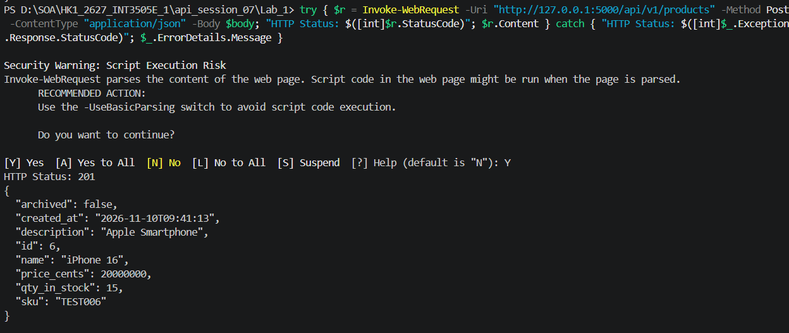

## 5. Cập nhật sản phẩm:
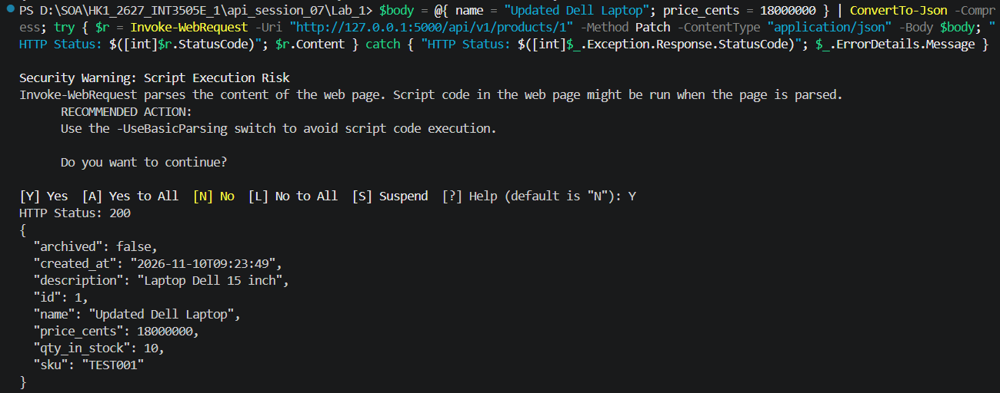

## 6. POST thiếu SKU/SKU đã tồn tại/Reserve vượt quá tồn kho:
POST thiếu SKU:

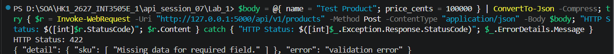

POST với SKU đã tồn tại:

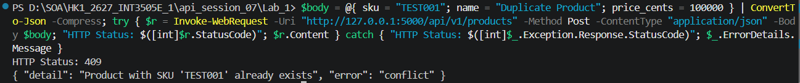

POST Reserve vượt quá tồn kho:

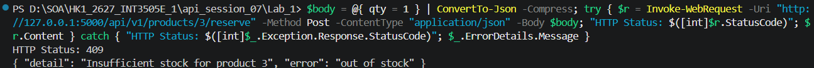

## 7. POST/PATCH sản phẩm giá âm:
POST:

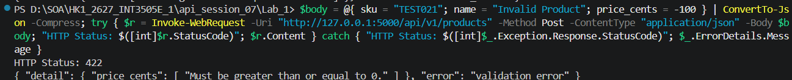

PATCH:

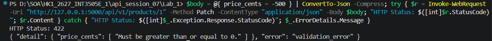

## 8. Xoá sản phẩm:
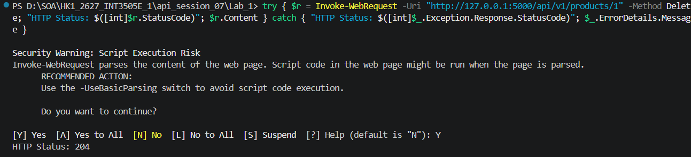

