# BTVN TUẦN 9: 

# PRACTICE 1:

## 1. Chạy server:
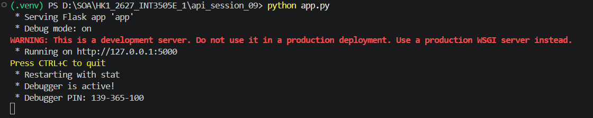

## 2. Test API v1/v2, user not found:

API v1:

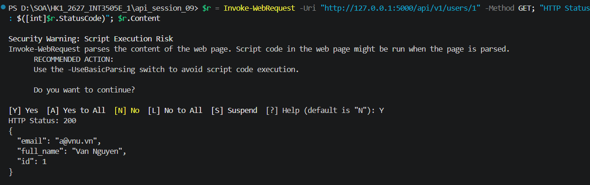

API v2:

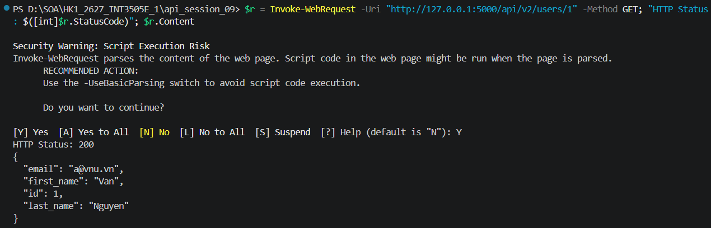

User not found:

# PRACTICE 2:

## 1. Chạy server:
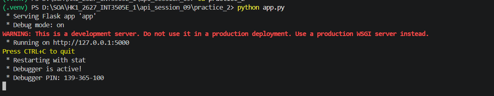

## 2. Kết quả khi không truyền version:

Kết quả trả về sẽ giống với v2 của Practice 1:

## 3. Kết quả khi truyền v1:

## 3. Kết quả khi truyền date version:

## 4. Kết quả khi truyền version không hợp lệ:

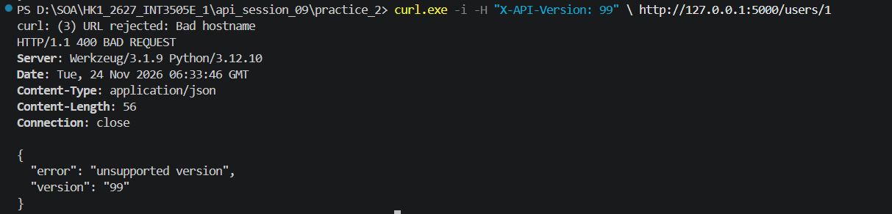

# PRACTICE 3:

## 1. Chạy server:
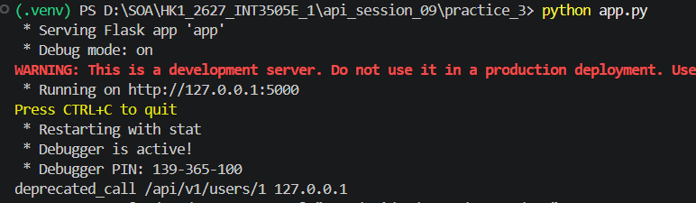

## 2. Kết quả khi gọi API trước/sau ngày Sunset:

Trước ngày Sunset:

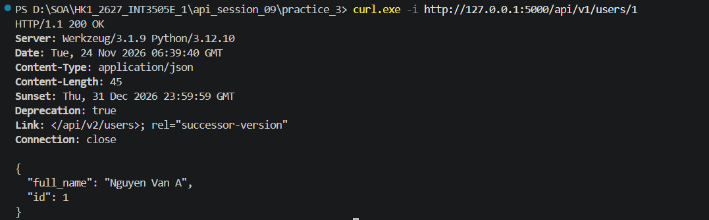

Sau ngày Sunset:

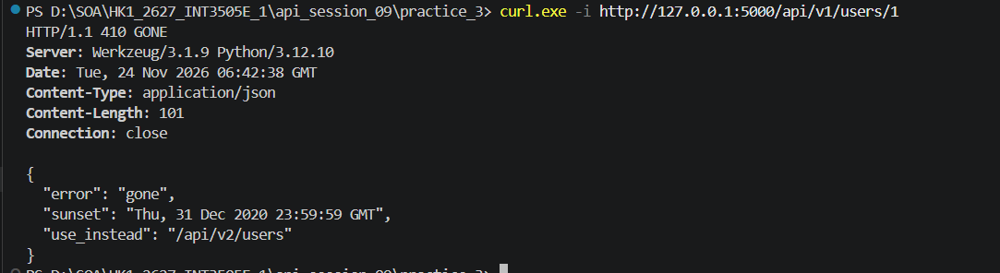

# PRACTICE 4:

## 1. Chạy server:
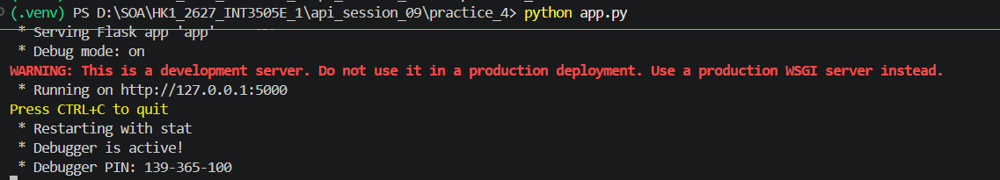

## 2. Test Cohort beta:

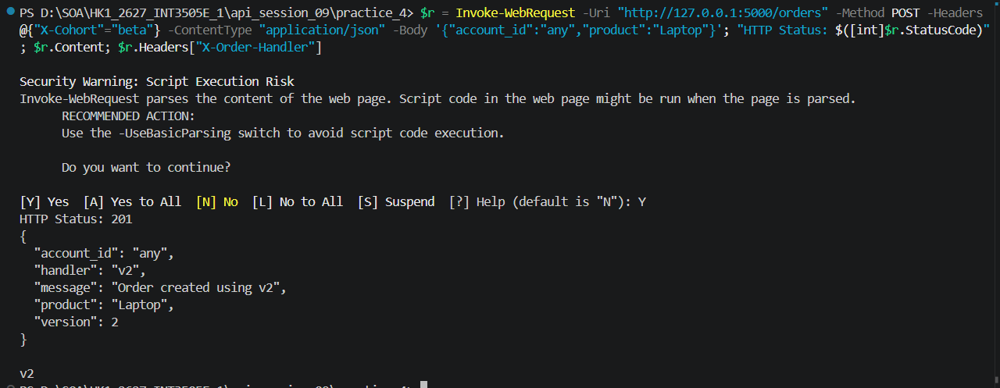

## 3. Test Account trong allow-list:

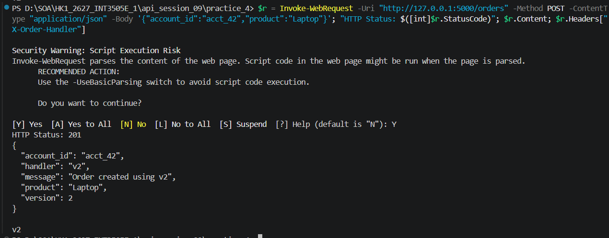

## 4. Test Account thông thường - hash bucket 5%:

Với Rollout 5%:

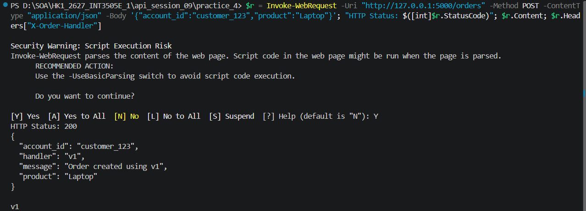

Với Rollout 100%:

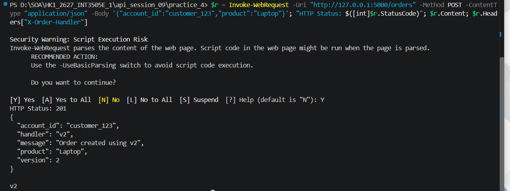

## 5. Test Sunset:

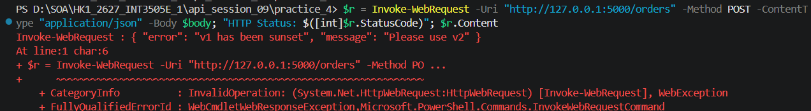

## 6. Test routing khi v1 đến Sunset:

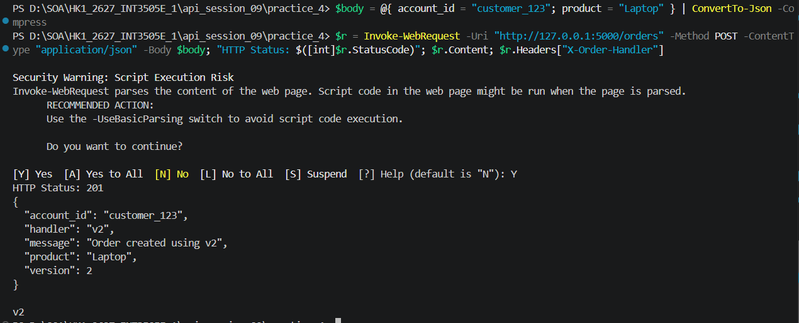