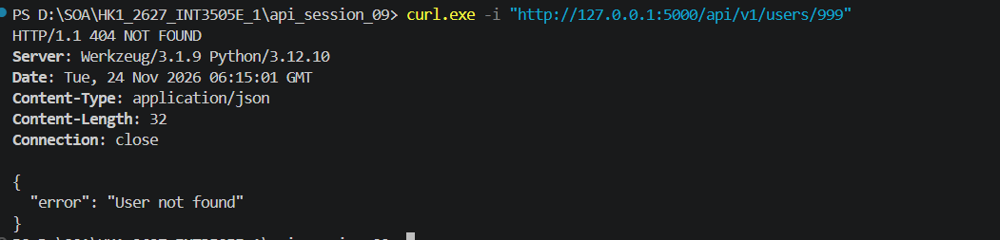
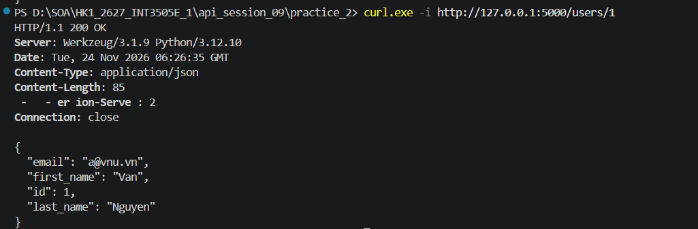
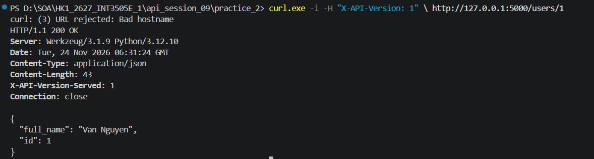
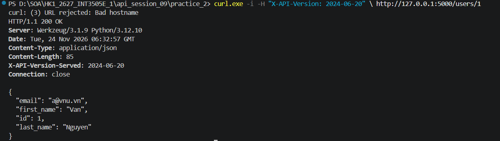

# BTVN TUẦN 9: 

# PRACTICE 1:

## 1. Chạy server:

## 2. Test API v1/v2, user not found:

API v1:

API v2:

User not found:

# PRACTICE 2:

## 1. Chạy server:

## 2. Kết quả khi không truyền version:

Kết quả trả về sẽ giống với v2 của Practice 1:

## 3. Kết quả khi truyền v1:

## 3. Kết quả khi truyền date version:

## 4. Kết quả khi truyền version không hợp lệ:

